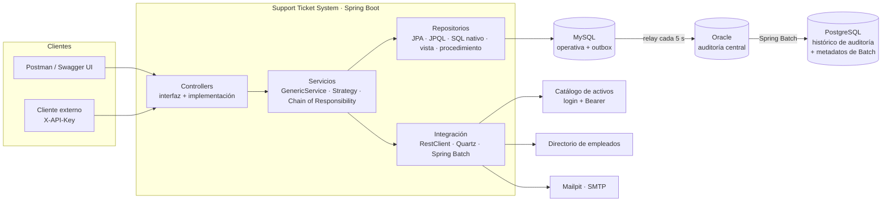
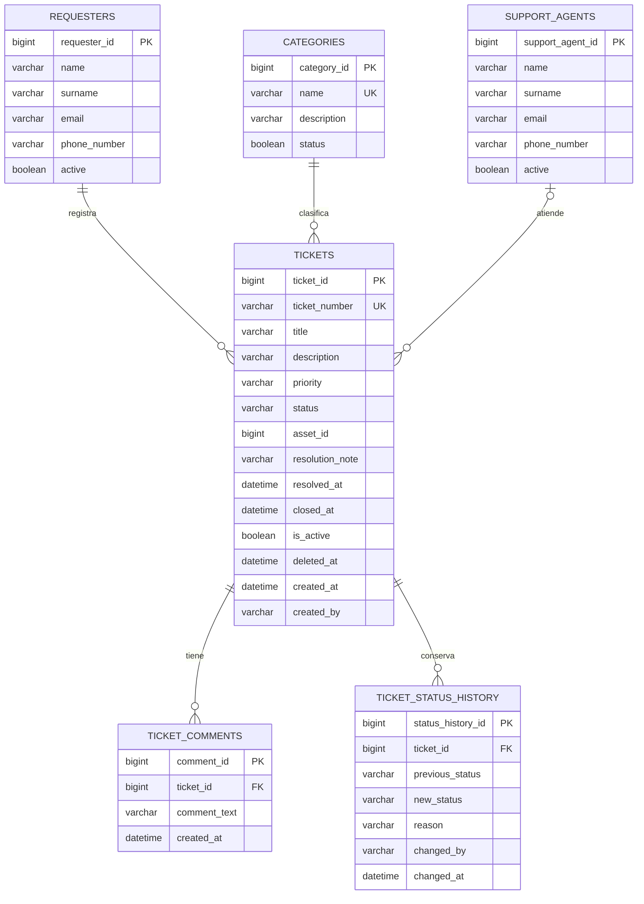
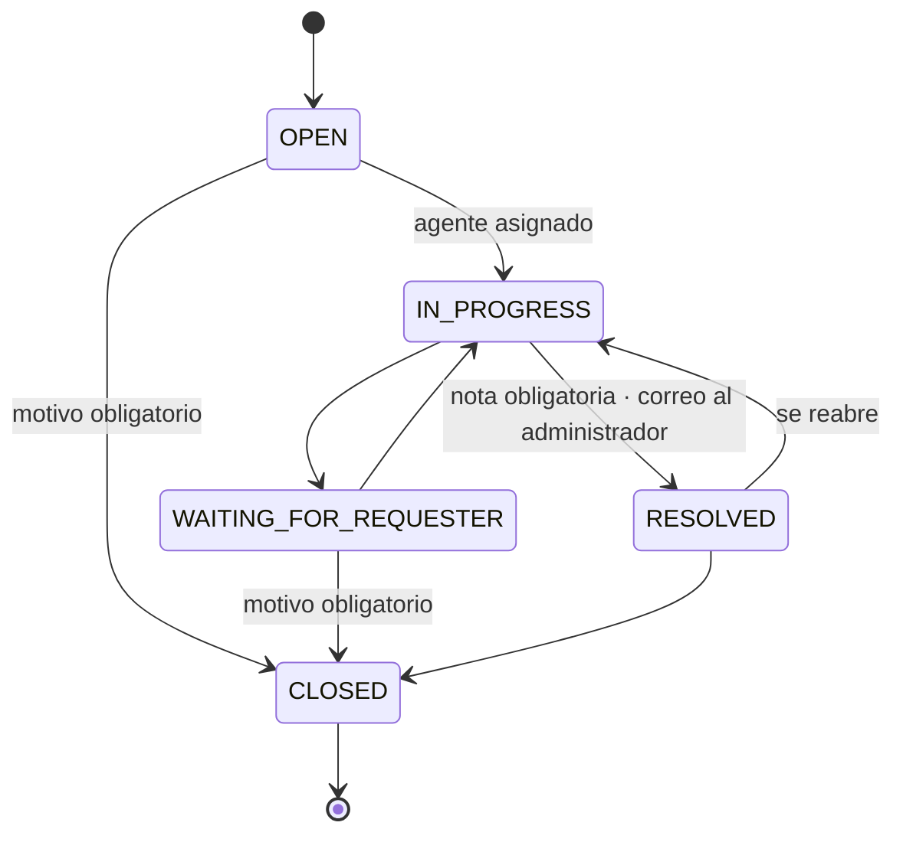

<div align="center">

# Support Ticket System

**API REST para registrar, atender y dar seguimiento a tickets de soporte de TI**

Monolito modular en capas con Spring Boot, tres bases de datos, integraciones externas, jobs y procesamiento batch.


</div>

---

## Contenido

- [Descripción](#descripción)
- [Funcionalidades](#funcionalidades)
- [Arquitectura](#arquitectura)
- [Modelo de datos](#modelo-de-datos)
- [Ciclo de vida del ticket](#ciclo-de-vida-del-ticket)
- [Tecnologías](#tecnologías)
- [Cómo ejecutar](#cómo-ejecutar)
- [Endpoints](#endpoints)
- [Pruebas y documentación](#pruebas-y-documentación)
- [Estructura del proyecto](#estructura-del-proyecto)
- [Evolución del proyecto](#evolución-del-proyecto)
- [Autor](#autor)

## Descripción

El área de soporte de TI recibe solicitudes por correo, chat y llamadas, sin un registro común ni trazabilidad. **Support Ticket System** centraliza esas solicitudes en tickets con número legible (`TCK-2026-000123`), prioridad, categoría, agente asignado y un ciclo de vida controlado, y deja rastro de cada acción en una auditoría central.

Es un backend REST, sin interfaz gráfica: se usa con Swagger UI, Postman o cualquier cliente HTTP.

## Funcionalidades

<details open>
<summary><b>Gestión de tickets</b></summary>

- Creación siempre en `OPEN`, con número legible y validación en cadena de solicitante, categoría, agente y activo de TI.
- Cambio de estado con transiciones permitidas, nota de resolución obligatoria y motivo al cerrar sin resolver.
- Historial de estados con motivo y usuario, comentarios de seguimiento y borrado lógico.
- Listado paginado con filtros, búsqueda por número y por texto, listado resumido e indicadores.

</details>

<details>
<summary><b>Integraciones</b></summary>

| Integración | Tipo | Seguridad |
|---|---|---|
| Catálogo de activos de TI | Saliente (servicio externo) | Login y token `Bearer`, renovado si vence |
| Directorio de empleados | Saliente (servicio interno) | Sin seguridad |
| Portal de clientes | Entrante | Header `X-API-Key` |
| Correo al resolver un ticket | Job de Quartz cada 30 s | — (Mailpit en desarrollo) |
| Histórico de auditoría | Spring Batch a demanda | — |

</details>

<details>
<summary><b>Auditoría en tres bases</b></summary>

Cada petición a la API y cada evento de negocio se guarda primero en una **bandeja de salida (outbox)** de MySQL, dentro de la misma transacción. Un proceso programado la lleva a la **auditoría central en Oracle** cada 5 segundos, sin duplicar. A demanda, **Spring Batch** copia esos eventos al **histórico en PostgreSQL**, de forma incremental, clasificados y con sus datos principales extraídos.

</details>

## Arquitectura



**Capas y componentes**

| Capa | Componentes |
|---|---|
| Controller | Interfaces con los mapeos y la documentación OpenAPI; implementaciones que heredan de `GenericControllerImpl`. Rutas en `APIEndPoints` (`/api/v1`), respuestas `CustomResponse` y un único `@RestControllerAdvice` |
| Servicio | `GenericService` / `GenericServiceImpl` parametrizado con interfaces funcionales (`Function`, `BiConsumer`); servicios especializados para tickets, consultas, portal, notificaciones y batch |
| Dominio | Transiciones en el enum `TicketStatus`; **Strategy** con una estrategia por estado destino; **Chain of Responsibility** para validar solicitante → categoría → agente → activo |
| Persistencia | `GenericEntity` con auditoría JPA; Specifications; JPQL con `join fetch`; SQL nativo con Projection; vista `vw_ticket_summary` como VO de solo lectura; procedimiento `usp_ticket_indicators` |
| Integración | Clientes `RestClient` con timeouts; relay del outbox; job de Quartz para el correo; job de Spring Batch para el histórico |
| Componentes propios | `@ValidPhone`, `@ValidTicketNumber`, interceptores de auditoría HTTP y de API key |

## Modelo de datos

Base operativa (MySQL):



Además, MySQL guarda la bandeja de salida (`audit_outbox`) y los correos pendientes (`ticket_notifications`). Oracle guarda `audit_event`. PostgreSQL guarda `audit_event_history`, la parametrización de los jobs (`batch_job_config`) y las tablas de metadatos de Spring Batch (`batch_job_execution`, `batch_step_execution`, …). No hay claves foráneas entre bases.

## Ciclo de vida del ticket



Una transición que no está en el diagrama responde `409 Conflict`.

## Tecnologías

| Categoría | Tecnología |
|---|---|
| Lenguaje y framework | Java 25, Spring Boot 4.1.2 (Spring MVC, Data JPA, Validation) |
| Persistencia | Hibernate 7, Spring Data JPA, JDBC, HikariCP (un pool por base) |
| Bases de datos | MySQL 8.4 (operativa), Oracle Database Free (auditoría), PostgreSQL 17 (histórico); H2 en el perfil local |
| Mapeo y utilidades | MapStruct 1.6, Lombok, Jackson 3 |
| Integración | `RestClient`, Quartz, Spring Batch 6, Spring Mail |
| Documentación | springdoc-openapi 3 (Swagger UI), Spring REST Docs + Asciidoctor, Postman |
| Pruebas | JUnit 5, Mockito, AssertJ, MockMvc, Newman |
| Infraestructura | Docker, Docker Compose, Mailpit |

## Cómo ejecutar

### Requisitos

- Docker y Docker Compose.
- Conexión a internet para los servicios externos (catálogo de activos y directorio de empleados).

### Con Docker Compose

1. Crea el archivo `.env` a partir del ejemplo y cambia las claves:

   ```bash
   cp .env.example .env
   ```

2. Levanta todo:

   ```bash
   docker compose up -d --build
   ```

   La primera vez Oracle tarda varios minutos en arrancar; el script `infrastructure/oracle/startup/01-create-audit-user.sh` crea el usuario de auditoría si no existe. La construcción de la imagen ejecuta todas las pruebas y genera la documentación REST Docs.

3. Abre:

   | Recurso | URL |
   |---|---|
   | API | http://localhost:8081/api/v1 |
   | Swagger UI | http://localhost:8081/swagger-ui.html |
   | REST Docs | http://localhost:8081/docs/index.html |
   | Mailpit (correos) | http://localhost:8025 |

   Todos los recursos de Docker llevan el prefijo `support-ticket-system`. El log del batch queda en `logs/batch/audit-history.log`.

### Perfil local (sin Docker)

```bash
./mvnw spring-boot:run
```

Usa tres bases H2 en memoria en lugar de MySQL, Oracle y PostgreSQL, en el puerto 8080. Los indicadores responden `501` (H2 no ejecuta el procedimiento de MySQL) y los correos quedan pendientes, porque no hay servidor SMTP.

### Variables de entorno

| Variable | Uso |
|---|---|
| `MYSQL_*` | Base operativa |
| `ORACLE_PASSWORD`, `ORACLE_AUDIT_USERNAME`, `ORACLE_AUDIT_PASSWORD` | Auditoría central |
| `HISTORY_DB_NAME`, `HISTORY_DB_USERNAME`, `HISTORY_DB_PASSWORD`, `HISTORY_DB_PORT` | Histórico de auditoría (PostgreSQL) |
| `TICKET_ADMIN_EMAIL` | Destinatario de los correos de tickets resueltos |
| `PORTAL_API_KEY` | Clave del portal de clientes |
| `ASSETS_API_EMAIL`, `ASSETS_API_PASSWORD` | Usuario del catálogo de activos |

## Endpoints

Todas las respuestas usan el sobre `CustomResponse` (`status`, `message`, `timestamp`, `data`). El header opcional `X-User-Id` identifica al usuario en la auditoría.

| Recurso | Endpoints |
|---|---|
| Categorías, solicitantes, agentes | `GET`, `POST` `/api/v1/{categories\|requesters\|support-agents}` · `GET`, `PUT`, `DELETE` `.../{id}` |
| Solicitante desde el directorio | `POST /api/v1/requesters/from-directory/{employeeId}` |
| Tickets | `GET`, `POST /api/v1/tickets` · `GET`, `PUT`, `DELETE /api/v1/tickets/{id}` · `PATCH /api/v1/tickets/{id}/status` · `GET /api/v1/tickets/{id}/status-history` |
| Comentarios | `GET`, `POST /api/v1/tickets/{ticketId}/comments` |
| Consultas | `GET /api/v1/tickets/number/{ticketNumber}` · `/search?text=` · `/summary` · `/indicators` · `/{id}/asset` |
| Portal de clientes | `GET /api/v1/portal/tickets/{ticketNumber}` (header `X-API-Key`) |
| Histórico de auditoría | `POST /api/v1/batch/audit-history` · `GET /api/v1/batch/audit-history/summary` |

El detalle de cada endpoint, con ejemplos reales de petición y respuesta, está en Swagger UI y en REST Docs.

## Pruebas y documentación

```bash
./mvnw test
```

- **Pruebas unitarias:** transiciones de estado (las 25 combinaciones), estrategias, cadena de validación, servicio de consultas, validadores, interceptor de API key, envío de correos con reintentos, clasificación de eventos y parámetros del batch.
- **REST Docs:** `ApiDocumentationTest` ejecuta cada endpoint contra la aplicación real (perfil local) y genera los fragmentos; `./mvnw package` los convierte en `/docs/index.html`.
- **Postman:** importa `docs/JavaArchitecture.postman_collection.json`. Cada carpeta corresponde a una etapa del proyecto, y `12-demo` es el recorrido completo de la demostración. Para el portal, asigna a la variable `portalApiKey` el valor de `PORTAL_API_KEY`.

## Estructura del proyecto

```text
src/main/java/com/co/support/it/support_ticket_system
├── business/            # Módulos de negocio: controller, service, repository, dto, mapper…
│   ├── category/
│   ├── requester/
│   ├── supportagent/
│   ├── ticket/          # Dominio (estados), Strategy, Chain of Responsibility, consultas
│   ├── portal/          # Portal de clientes externos
│   ├── notification/    # Correo con Quartz
│   ├── batch/           # Histórico de auditoría con Spring Batch
│   └── shared/          # Constantes de rutas, excepciones, validadores, configuración
├── generic/             # Controller, servicio, entidad, repositorio, mapper y excepciones genéricos
├── infrastructure/      # Datasources (Oracle, PostgreSQL), outbox, interceptores web
└── integration/         # Clientes de servicios externos y relay de auditoría

src/main/resources
├── db/                  # Vista, procedimiento, datos iniciales y esquema del histórico
└── logback-spring.xml   # Log dedicado del batch
src/docs/asciidoc/       # Plantilla de REST Docs
infrastructure/oracle/   # Script que crea el usuario de auditoría en Oracle
docs/                    # Lineamientos, requerimientos, roadmap y colección de Postman
```

## Evolución del proyecto

El proyecto se construyó por etapas, cada una en su propia rama `architecture/NN-nombre`:

| Etapa | Resultado |
|---|---|
| 01–05 | Capas, servicio, DTOs y validación, modelo relacional y arquitectura por funcionalidad |
| 06 | MySQL + Oracle, auditoría con outbox y Docker Compose |
| 07 | Base REST: `CustomResponse`, controllers y servicio genéricos, auditoría JPA |
| 08 | Ciclo de vida del ticket, Strategy y Chain of Responsibility |
| 09 | JPQL, SQL nativo con Projection, vista y procedimiento almacenado |
| 10 | Integraciones con token, directorio interno, portal con API key y correo con Quartz |
| 11 | PostgreSQL e histórico de auditoría con Spring Batch |
| 12 | Swagger, REST Docs, README y demostración |

El detalle está en [`docs/03-roadmap-arquitectura.md`](docs/03-roadmap-arquitectura.md), y el análisis en [`docs/02-analisis-de-requerimientos.md`](docs/02-analisis-de-requerimientos.md).

## Autor

**Jairo Alejandro Castañeda Pedraza**

[](https://github.com/JairoCastanedaP)
